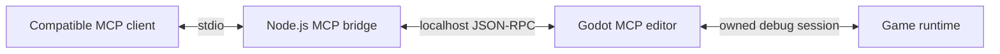

# Godot MCP

**Built-in Godot editor and runtime automation for compatible AI coding agents.**
One standard Model Context Protocol (MCP) bridge, independent of any agent brand.

## Download

**[Get Godot MCP 0.3.0 for Windows x64](https://github.com/chen9916/godot-mcp/releases/tag/godot-mcp-v0.3.0)**
· **[Quick start](MCP_QUICKSTART.md)** · **[Verification and support scope](MCP_STATUS.md)**

The portable ZIP contains everything needed to connect an agent to this editor:

| Included | Details |
| --- | --- |
| Godot editor | Custom Godot **4.8-dev**, with built-in MCP and a console companion. |
| MCP bridge | **83 tools**; bundled Node.js and locked production dependencies. |
| Windows exports | Matching x64 debug/release templates and console companions, preinstalled. |
| Easy setup | Double-click setup and connection-check launchers; no separate npm install or compilation. |
| Release evidence | Source/file manifest, SHA-256 checksums, and the passing verification report. |

**This is a custom development build, not an official stable Godot release.**
Back up projects first. Binaries are unsigned. Only Windows x64 binaries and
templates are provided; other platforms are not release-verified.

## Start in five steps

1. Download the ZIP and extract it into a permanent writable folder.
2. Open your game project in the bundle's **Godot.exe**.
3. Enable **Editor Settings > Network > Godot MCP**.
4. Run **Setup.cmd** to choose your agent, or **Setup-OpenCode.cmd** for OpenCode.
5. Refresh/reopen the agent, then run **Check-Connection.cmd**.

Setup supports **Codex, OpenCode, Hermes, Antigravity, Claude Code, and Claude
Desktop** configurations. It backs up existing files and preserves unrelated
settings. Standard MCP stdio also works with other compatible clients through
manual configuration export. Application-specific compatibility is not a claim
that every agent version has been tested.

Read [the quick start](MCP_QUICKSTART.md) for upgrades, project selection,
troubleshooting, and safe removal. The editor must stay open while tools are used.

## What agents can do

- **Scenes and resources:** inspect nodes, create/edit scenes and resources,
  connect signals, import assets, and apply guarded multi-operation scene patches.
- **Scripts:** inspect editor buffers, validate GDScript, reload safely, and use
  bounded language queries without silently discarding unsaved work.
- **Animation authoring:** inspect and edit libraries, clips, all track/key
  types, nested AnimationTree graphs, state machines, blend spaces, and filters.
- **Animation playback:** inspect and control owned debug runs through all 16
  animation actions, including transitions, one-shots, typed parameters, and
  root motion.
- **Runtime debugging:** inspect owned game runs, read/write properties, call
  methods, pause/step/resume, inject input, capture viewports, and read diagnostics.

Graph/animation patches use scene-version guards, local resource copies, dry
runs, and one undo action. Saving is explicit. Ordinary non-`@tool` AnimationTree
controller scripts and exported values are preserved; unsafe editor-executing
scripts and custom scripted AnimationNodes remain restricted.

The editor endpoint binds to localhost. Its internal TCP port is **not** an HTTP
MCP URL. Agents can change projects: review changes and use version control.
Cancellation/timeouts stop waiting, not necessarily an already-dispatched edit.
Release exports do not expose the debug-only MCP runtime integration.

## Verified release

The 0.3.0 package passed **all 11 release gates**, covering dependency auditing,
bridge tests, native regressions, packaged setup/discovery, real editor
restart/reconnect and moved-bundle checks, animation/protocol/runtime/settings
workflows, and Windows exports.

- 90 native MCP tests / 2,234 assertions, plus 3 UndoRedo tests / 51 assertions.
- 89 default bridge tests passed; the optional editor workflows were run through
  the separate isolated release checks, not inferred from skipped tests.
- Actual Windows debug/release exports and all four standalone main/console runs.
- No reported dependency vulnerabilities; archive CRCs, inventory and entry
  hashes checked before upload.

The downloadable release is pinned to **`godot-mcp-v0.3.0`**, source commit
**`e36894e167`**. `master` may include subsequent documentation updates. See the
attached verification report and [MCP_STATUS.md](MCP_STATUS.md) for exact evidence
and limits; these checks do not certify every GPU driver, renderer, extension or
game project.

## Source and documentation

| Area | Reference |
| --- | --- |
| User setup and troubleshooting | [Quick start](MCP_QUICKSTART.md) · [Bridge guide](misc/godot_mcp_bridge/README.md) |
| Tool contracts | [Automation tools](editor/debugger/godot_mcp/AUTOMATION_TOOLS_V2.md) · [Animation tools](editor/debugger/godot_mcp/ANIMATION_TOOLS.md) |
| Architecture | [Design and safety](editor/debugger/godot_mcp/ARCHITECTURE.md) |
| Native editor integration | [`editor/debugger/godot_mcp`](editor/debugger/godot_mcp) |
| Runtime integration | [`scene/debugger/godot_mcp_runtime_debugger.cpp`](scene/debugger/godot_mcp_runtime_debugger.cpp) |
| Standard MCP bridge and setup | [`misc/godot_mcp_bridge`](misc/godot_mcp_bridge) |
| Build, tests and packaging | [Reproduction guide](misc/godot_mcp_bridge/test/README.md) |
| Current verification and boundaries | [Release status](MCP_STATUS.md) |

For source development, build the bridge with `npm ci`, `npm run build`, and
`npm test` inside `misc/godot_mcp_bridge`. Native editor/template builds require
the Godot build toolchain; use the reproduction guide rather than the portable
user setup instructions.

### Upgrading from the old OpenCode-only fork

The maintained implementation is now `godot_mcp` / `godot_mcp_bridge`, with editor
settings under `network/godot_mcp`. Register the new `godot` connection and disable
the legacy `godot-opencode` registration separately. Do not run both bridges.

## Support and contributions

[Report an MCP/setup bug](https://github.com/chen9916/godot-mcp/issues/new?template=mcp_bug_report.yml)
· [Request an MCP feature](https://github.com/chen9916/godot-mcp/issues/new?template=mcp_feature_request.yml)
· [Contribute](CONTRIBUTING.md)

Include the release, editor and client versions and a small reproduction.
Remove credentials and private paths from diagnostics; never attach `session.json`
or a complete client configuration. Engine problems that also reproduce in an
official Godot build belong in the upstream engine tracker.

## Upstream and license

This project is a fork of [Godot Engine](https://godotengine.org), the free and
open-source 2D/3D engine. It is not an official Godot distribution. Godot and the
MCP integration use the [MIT license](LICENSE.txt); bundled third-party terms
remain in [COPYRIGHT.txt](COPYRIGHT.txt) and the release notices.

[Upstream source](https://github.com/godotengine/godot) ·
[Official Godot documentation](https://docs.godotengine.org) ·
[Godot contributors](AUTHORS.md) · [Contributing](CONTRIBUTING.md)
